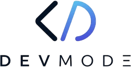
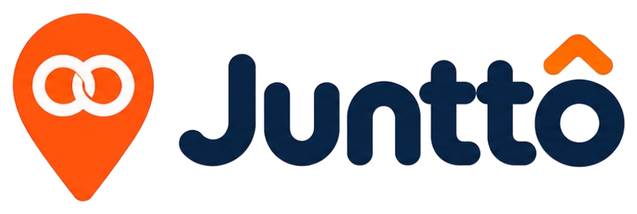

#  +  

 
[](https://github.com/DevMode-Juntto/Front-End-Design-Engineering)

---

## 🔴 Índice

- [Descrição do Projeto](#-descrição-do-projeto)
- [Sobre](#sobre)
- [Tecnologias Utilizadas](#-tecnologias-utilizadas)
- [Estrutura de Pastas](#-estrutura-de-pastas)
- [Páginas do Site](#-páginas-do-site)
- [Páginas dos Protótipos](#-páginas-dos-protótipos)
- [Imagens e Ícones](#-imagens-e-ícones)
- [Integrantes](#-integrantes)
- [Como Usar](#-como-usar)
- [Links do Projeto](#-links-do-projeto)
- [Contato](#-contato)
- [Contribuições](#-contribuições)
- [Padrão de Commits](#-padrão-de-commits)

---

## 🔴 Descrição do Projeto

O projeto consiste na integração de um avatar inteligente e interativo à plataforma SoulUp, com o objetivo de proporcionar interações personalizadas e aumentar o engajamento dos usuários.

O avatar Oli, integrado à proposta de Inteligência Artificial, acompanha missões, oferece dicas e incentiva práticas sustentáveis, transformando as ações dos usuários em Pontos ECOA.

---

## 🔴 Sobre

O Junttô é uma plataforma que conecta pessoas de uma mesma comunidade, facilitando a troca de ajuda e a divulgação de oportunidades. Por meio dela, os usuários podem publicar pedidos, oferecer serviços e encontrar pessoas dispostas a colaborar

O projeto tem como objetivo incentivar a solidariedade, a inclusão social e o fortalecimento da economia local, tornando a ajuda mais acessível e aproximando pessoas
---

## 🔴 Tecnologias Utilizadas


---

## 🔴  Estrutura de Pastas

```text
my-app/
│
├── public/
├── src/
│   ├── components/
│   │   ├── Autenticacao/
│   │   ├── AvisoDenuncia/
│   │   ├── Botao/
│   │   ├── BotaoAutenticacao/
│   │   ├── CampoAutenticacao/
│   │   ├── CampoDenuncia/
│   │   ├── CampoFeedback/
│   │   ├── Card/
│   │   ├── CardIntegrante/
│   │   ├── CardPergunta/
│   │   ├── Chat/
│   │   ├── Menu/
│   │   ├── Perfil/
│   │   ├── ResumoRecebimento/
│   │   ├── Rodape/
│   │   └── Titulo/
│   │
│   ├── img/
│   │
│   ├── pages/
│   │   ├── Admin/
│   │   ├── Cadastro/
│   │   ├── ConfirmacaoRecebimento/
│   │   ├── Contato/
│   │   ├── Denuncia/
│   │   ├── FAQ/
│   │   ├── Finalizacao/
│   │   ├── Historico/
│   │   ├── Home/
│   │   ├── HomePrototipo/
│   │   ├── Integrantes/
│   │   ├── Login/
│   │   ├── Perfil/
│   │   ├── PublicarPedido/
│   │   └── Sobre/ 
│   │
│   ├── services/
│   │   └── api.ts   
│   │
│   ├── types/
│   │   └── types.ts
│   │
│   ├── App.tsx
│   ├── base.css
│   └── main.tsx   
│ 
├── .env.example
├── package.json
├── index.html
└── vite.config.ts

```

---


## 🔴 Páginas do Site

[Home](./src/pages/Home/index.tsx) | - Página inicial que apresenta o projeto Junttô.

[Sobre](./src/pages/Sobre/index.tsx) | - Apresenta a ideia, os objetivos e a proposta da plataforma.

[Integrantes](./src/pages/Integrantes/index.tsx) | - Apresenta os integrantes da equipe.

[FAQ](./src/pages/FAQ/index.tsx) | - Principais dúvidas sobre o projeto e a plataforma.

[Contato](./src/pages/Contato/index.tsx) | - Página destinada ao contato com a equipe do projeto.

[Login](./src/pages/Login/index.tsx) | - Permite que o usuário entre na plataforma utilizando seu e-mail e senha.

[Cadastro](./src/pages/Cadastro/index.tsx) | - Permite o cadastro de um novo usuário na plataforma.

---

## 🔴 Páginas dos Protótipos

[Home](./src/pages/HomePrototipo/index.tsx) | - Painel principal do usuário com oportunidades de ajuda, categorias, notificações e ajudas em processo.

[Publicar pedido](./src/pages/PublicarPedido/index.tsx) | - Permite publicar um pedido de ajuda.

[Histórico](./src/pages/Historico/index.tsx) | - Apresenta os serviços realizados, pedidos publicados, candidaturas, pagamentos, comentários e denúncias do usuário.

[Perfil](./src/pages/Perfil/index.tsx) | - Mostra o perfil e comentários sobre o usuário.

[Denúncia](./src/pages/Denuncia/index.tsx) | - Permite criar uma denúncia relacionada a outro usuário.

[Finalização](./src/pages/Finalizacao/index.tsx) | - Permite que o solicitante registre o pagamento enviado e avalie o prestador após a realização da ajuda.

[Confirmação de recebimento](./src/pages/ConfirmacaoRecebimento/index.tsx) | - Permite que o prestador confirme o recebimento do pagamento e avalie o solicitante.

[Painel administrador](./src/pages/Admin/index.tsx) | - Área administrativa

> As páginas desta seção são protótipos navegáveis para demonstração dos fluxos da plataforma.


---

## 🔴 Imagens e Ícones

As imagens são:

- logo principal do Junttô.
- Imagens ilustrativas utilizadas nas páginas e nos cards.
- Ícones de navegação.
- fotos dos integrantes.

---

## 🔴 Integrantes

<table>
  <tr>
    <td align="center" width="20%">
      <a href="https://github.com/Felipecmf">
        
        <br />
        <strong>Felipe Fernandes Cabral Mota</strong>
      </a>
      <br />
      RM: 569432
      <br />
      Turma: 1TDSPY
      <br /><br />
      <a href="https://www.linkedin.com/in/felipe-fernandes-126887266/">
        
      </a>
      <br />
      <a href="https://github.com/Felipecmf">
        
      </a>
    </td>
    <td align="center" width="20%">
      <a href="https://github.com/helo0309">
        
        <br />
        <strong>Heloisa Costa Pereira</strong>
      </a>
      <br />
      RM: 572756
      <br />
      Turma: 1TDSPY
      <br /><br />
      <a href="https://www.linkedin.com/in/heloisa-costa-pereira-4a0810381/">
        
      </a>
      <br />
      <a href="https://github.com/helo0309">
        
      </a>
    </td>
    <td align="center" width="20%">
      <a href="https://github.com/isabellearaujod">
        
        <br />
        <strong>Isabelle Dantas de Araújo</strong>
      </a>
      <br />
      RM: 570167
      <br />
      Turma: 1TDSPY
      <br /><br />
      <a href="https://www.linkedin.com/in/isabelle-dantas-araujo/">
        
      </a>
      <br />
      <a href="https://github.com/isabellearaujod">
        
      </a>
    </td>
    <td align="center" width="20%">
      <a href="https://github.com/vtrzxy">
        
        <br />
        <strong>Vitor Reis Souza</strong>
      </a>
      <br />
      RM: 573315
      <br />
      Turma: 1TDSPY
      <br /><br />
      <a href="https://www.linkedin.com/in/vi-reis">
        
      </a>
      <br />
      <a href="https://github.com/vtrzxy">
        
      </a>
    </td>
    <td align="center" width="20%">
      <a href="https://github.com/Yasmin5511">
        
        <br />
        <strong>Yasmin Nunes dos Santos</strong>
      </a>
      <br />
      RM: 568618
      <br />
      Turma: 1TDSPY
      <br /><br />
      <a href="https://www.linkedin.com/in/yasmin-nunes-727202186/">
        
      </a>
      <br />
      <a href="https://github.com/Yasmin5511">
        
      </a>
    </td>
  </tr>
</table>


---

## 🔴 Como Usar

1. Clone o repositório:

```bash
git clone https://github.com/DevMode-Juntto/Front-End-Design-Engineering.git
cd Front-End-Design-Engineering/my-app
```

2. Instale as dependências:

```bash
npm install
```

3. O arquivo `.env` (modelo em `.env.example`) só vale no `npm run dev` e já aponta para as APIs no Render:

```bash
VITE_API_URL=https://juntto-java.onrender.com   # API Java (ou http://localhost:8080)
VITE_API_IA_URL=https://junnto-ia.onrender.com  # API de IA (ou http://localhost:5000)
VITE_API_PYTHON_URL=                            # API Python: deixe vazio enquanto não estiver publicada
```

4. Suba a API Java (veja o README do back-end) e rode o front:

```bash
npm run dev
```

Usuários de teste da API Java (criados pelo `script.sql`, senha `senha123`): `ana@email.com`, `bruno@email.com`, `carla@email.com`, `diego@email.com`, `elisa@email.com`, `felipe@email.com`.

### 🔴 Integração com as APIs

| Serviço | Arquivo | O que faz |
|---|---|---|
| API de IA (Flask, porta 5000) | `src/services/apiIA.ts` | Valor sugerido na tela Publicar e recomendações na Home |
| API Java | `src/services/api.ts` | Usuários, categorias, pedidos (AJUDA/OFERTA), candidaturas, avaliações e notificações |
| API Python | `src/services/apiPython.ts` | Painel de administração (`/admin`) e denúncias (`/denuncia`) |
| Tipos | `src/types/types.ts` | Interfaces TypeScript com os mesmos campos das respostas da API Java |

### 🔴 Deploy na Vercel

- **Root Directory:** `my-app` (o `vercel.json` fica dentro dela).
- Em produção o front chama `/api/...` e `/ia/...` no próprio domínio, e o `vercel.json` repassa para `https://juntto-java.onrender.com` e `https://junnto-ia.onrender.com`. Por isso não há erro de CORS e **nenhuma variável de ambiente é necessária na Vercel**.
- A API Python (admin e denúncias) ainda não está publicada: nessas telas o app mostra um aviso e as demais funções seguem normais. Quando ela estiver no ar, basta criar `VITE_API_PYTHON_URL` na Vercel e fazer Redeploy.
- Produção: https://junttodevmode1.vercel.app

### 🔴 Links do Projeto

- **Repositório GitHub:** https://github.com/DevMode-Juntto/Front-End-Design-Engineering
- **Vídeo de apresentação:** https://youtu.be/l4AhOikMkZ4
- **Projeto publicado:** https://junttodevmode1.vercel.app/
- **Url da API:** https://juntto-java.onrender.com/

---

## 🔴 Contato

Para dúvidas, sugestões ou mais informações sobre o projeto, entre em contato com a equipe DevMode pelos perfis do GitHub e LinkedIn disponibilizados na seção de integrantes.

---

## 🔴 Contribuições

Para colaborar com o projeto, siga as orientações abaixo:
- Descreva as alterações realizadas.
- Explique o objetivo da contribuição.
- Verifique se o código está funcionando corretamente.
- Aguarde a revisão antes de realizar o merge.

### 🔴 Padrão de Commits
 Prefixo     | Utilização                                     
 ----------- | ---------------------------------------------- 
 `feat:`     | Adição de uma nova funcionalidade.             
 `fix:`      | Correção de um erro.                           
